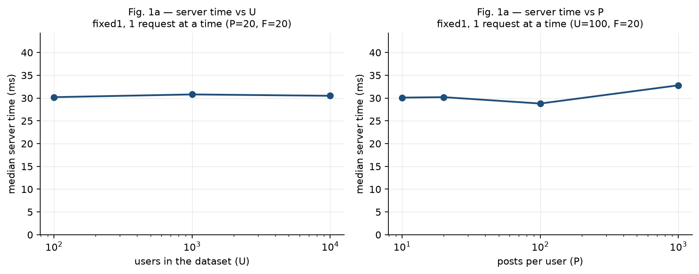

# TinyInsta passe-t-elle à l'échelle ?

Campagne de mesures — Projet Données massives et Cloud, édition 2026.
Rendu individuel · Hani Rahmoune · novembre 2026

- **Application déployée** : https://tinyinsta-b.ew.r.appspot.com
- **Sujet** : [SUJET.md](SUJET.md) · **Outils du dépôt** : [TOOLS.md](TOOLS.md), [bench/README.md](bench/README.md)

**Réponse courte.** TinyInsta passe à l'échelle sur deux dimensions (le nombre
d'utilisateurs U et le nombre de posts par utilisateur P), pas du tout sur la
troisième (le nombre de comptes suivis F), et passe à l'échelle en ressources
(ajouter des instances multiplie le débit presque linéairement) tout en étant
plafonnée à **~24 requêtes/s par instance** pour une raison qui n'est pas celle
que nous avions supposée.

Les 54 journaux bruts sont dans [`raw/`](raw/). Une seule commande régénère
toutes les figures et tous les CSV :

```sh
make figures          # = python scripts/analyze.py
```

---

## 1. Montage

| Élément | Valeur |
|---|---|
| Projet GCP | `tinyinsta-b` |
| Région App Engine | `europe-west1` (URL en `.ew.r.appspot.com`) |
| Base | Firestore **en mode Datastore**, emplacement `eur3` |
| Index composite | `Post(author ASC, created DESC)` — [`index.yaml`](index.yaml), état `READY` |
| Runtime | `python312`, Flask 3.0, gunicorn 21.2, google-cloud-datastore 2.19 |
| Classe d'instance | `F1` (version par défaut) · `B1` (versions `fixedN` et `fix1`) |
| Versions déployées | `default` (autoscaling ≤ 10), `fixed1`, `fixed2`, `fixed4`, `fix1` |
| Client de charge | Locust 2.47.0, exécuté depuis **Cloud Shell** (même région que l'application) |
| Dates | déploiement et index : 23/11/2026 · seeding : 24/11/2026 · mesures : 24–25/11/2026 |
| Jeux de données | 26 préfixes, ~400 000 entités, générés par [`bench/seed_exact.py`](bench/seed_exact.py) |

Chaque jeu contient `U` utilisateurs `<préfixe>_u00000 … <préfixe>_u<U-1>`, chacun
avec **exactement** `P` posts et suivant **exactement** `F` autres utilisateurs du
même jeu.

**Protocole d'exécution.** Les mesures sont pilotées par deux scripts :
[`bench/run_part1.sh`](bench/run_part1.sh) (partie 1) et
[`bench/run_sweep.sh`](bench/run_sweep.sh) (parties 2 et 3 — le même script, donc
*littéralement* le même protocole, comme l'exige la partie 3). Les deux refusent
de démarrer si l'en-tête `X-Instance` est absent de la réponse : sans ce garde-fou,
interroger une version arrêtée fait silencieusement répondre la version par
défaut, et toute la campagne mesurerait autre chose que ce qu'on croit.

L'analyse ([`scripts/analyze.py`](scripts/analyze.py)) écarte les **10 premières
secondes** de chaque run (démarrage à froid de l'instance), ne retient que les
réponses `200` pour les médianes, et compte le nombre d'instances distinctes
réellement vues dans `X-Instance`.

---

## 2. Résultats

### 2.1 Partie 1 — Coût d'une requête

**Protocole.** Version `fixed1` (manual scaling, 1 instance, B1), `-u 1` : une
seule requête en vol à tout instant, donc ni autoscaling ni file d'attente.
26 runs de 45 s, un seul facteur varie à la fois.

#### Hypothèses, déduites du code

`get_timeline` ([`main.py:38-73`](main.py)) fait deux choses :

1. `client.get(client.key('User', user))` ([`main.py:43`](main.py)) : une lecture
   **par clé**, donc à coût constant.
2. `SELECT * FROM Post WHERE author IN @authors ORDER BY created DESC` avec
   `limit=20` ([`main.py:53-55`](main.py)), servie par l'index composite.

- **U — prédiction : aucun effet.** La lecture par clé est un accès direct, et la
  requête ne balaie que les plages d'index des auteurs suivis. Les autres
  utilisateurs ne sont jamais touchés.
- **P — prédiction : aucun effet.** Pour chaque auteur, l'index est trié
  `created DESC` ; le moteur s'arrête après au plus `limit` entrées.
- **F — prédiction : coût croissant.** Datastore normalise un `IN` en une
  disjonction : une sous-requête par auteur, puis fusion des résultats triés.
  Avec `follows = list({*follows, user})` ([`main.py:47`](main.py)) il y a `F+1`
  auteurs, donc `F+1` plages d'index à parcourir et fusionner.
- **Risque identifié avant la mesure.** Datastore borne le nombre de disjonctions.
  Si la borne est franchie, l'exception est **avalée silencieusement**
  (`except Exception: pass`, [`main.py:57`](main.py)) et l'exécution bascule dans
  le repli final ([`main.py:66-72`](main.py)) : une requête **par auteur**,
  séquentielle, puis tri côté application. Aucun code HTTP ne le signale.

#### Figures



*Fig. 1a — temps serveur médian en fonction de U (P=20, F=20) et de P (U=100, F=20).
Données : [`figures/fig1a.csv`](figures/fig1a.csv). Axe des ordonnées à partir de 0,
pour que la platitude soit jugeable.*


*Fig. 1b — temps serveur médian et latence client médiane en fonction de F
(U=120, P=20, limit=20). Données : [`figures/fig1b.csv`](figures/fig1b.csv).*

#### Interprétation

**U : hypothèse confirmée.** 30,2 / 30,8 / 30,5 ms pour U = 100 / 1 000 / 10 000,
soit un écart total de **0,6 ms (2 %)** pour un facteur 100 sur le volume de
données. La courbe est plate. Mécanisme : la lecture par clé est un accès direct,
et la requête ne touche que les plages d'index des 21 auteurs concernés — les
9 979 autres utilisateurs du jeu `u10k` n'existent pas pour elle. C'est
exactement ce que le sharding achète : le coût dépend des données *lues*, pas des
données *stockées*.

**P : hypothèse confirmée.** 30,1 / 30,2 / 28,8 / 32,8 ms pour P = 10 / 20 / 100 /
1 000, soit **4 ms (12 %)** d'écart pour un facteur 100. La légère hausse à
P = 1 000 n'est pas une croissance en P : elle est du même ordre que la dispersion
entre runs. Le `limit=20` fait que l'on s'arrête après 20 entrées d'index par
auteur, qu'il y en ait 10 ou 1 000 derrière.

**Contrôle croisé.** Le point F = 20 est mesuré **quatre fois de façon
indépendante**, sur quatre jeux de tailles différentes : `u100` (U=100) → 30,2 ms,
`base` (U=1 000) → 30,8 ms, `u10k` (U=10 000) → 30,5 ms, `f20` (U=120) → 31,4 ms.
Dispersion maximale : **1,2 ms**. Quatre mesures qui coïncident à 4 % près
confirment la platitude en U bien mieux qu'une courbe seule.

**F : hypothèse confirmée dans son principe, mais totalement ratée dans sa
forme.** Nous attendions une croissance continue. La mesure montre **deux régimes
séparés par une falaise** :

| F | 5 | 10 | 15 | 20 | 25 | **30** | 50 | 75 | 100 |
|---|---|---|---|---|---|---|---|---|---|
| temps serveur médian (ms) | 29,1 | 29,8 | 30,8 | 31,4 | 32,8 | **577,5** | 908,1 | 1 364,2 | 1 758,9 |

- **F ≤ 25 : pente 0,18 ms par followee.** Pratiquement plat. Datastore fusionne
  les `F+1` plages d'index efficacement ; le coût d'un followee supplémentaire est
  négligeable devant les ~30 ms de base.
- **Entre F = 25 et F = 30 : × 17,6 d'un coup** (32,8 → 577,5 ms).
- **F ≥ 30 : pente 16,85 ms par followee**, soit **94 fois** la pente du premier
  régime, jusqu'à 1 759 ms à F = 100.

Le mécanisme est celui que nous redoutions, et la position de la falaise le
prouve. `main.py:47` construit `F+1` auteurs : à F = 25 cela fait 26 auteurs, à
F = 30 cela fait **31**, ce qui dépasse la limite de 30 valeurs du `IN` de
Datastore. La requête GQL lève alors une exception, celle-ci est **avalée** à
[`main.py:57`](main.py), et l'exécution tombe dans le repli
[`main.py:66-72`](main.py) : `F+1` requêtes **séquentielles**, une par auteur.
La pente de 16,85 ms/followee est tout simplement le coût d'un aller-retour
Datastore supplémentaire par followee — cohérent avec les ~14 ms de latence
réseau mesurés par ailleurs.

Conséquence opérationnelle : le débit s'effondre de **21 req/s à 0,55 req/s**
entre F = 25 et F = 100, et **pas une seule réponse HTTP n'est en erreur**. Le
service continue de répondre `200` en étant 55 fois plus lent. C'est le pire
mode de défaillance possible : invisible en supervision.

#### Réponses aux questions du sujet

**1. Les hypothèses sont-elles confirmées ?**
U et P : oui, sans réserve. F : le sens est le bon (le coût croît avec F) mais
nous avions prédit une droite, et la réalité est une fonction en escalier. Ce que
nous avions manqué, c'est que la limite du `IN` de Datastore transforme un
changement quantitatif en **changement de chemin de code**. Nous avions identifié
le risque en lisant `main.py:57`, mais nous l'attendions à F = 100 (en raisonnant
sur une limite de 100 disjonctions) ; la mesure le place à F = 30, donc la limite
effective porte sur **30 valeurs dans le `IN`**, pas sur 100 disjonctions.

**2. Quelle part de la latence client est due au réseau ?**
La colonne `network_ms_median` de [`figures/fig1b.csv`](figures/fig1b.csv) donne
`latence client − temps serveur` : elle vaut entre **12,8 et 17,0 ms**, médiane
**~14,4 ms**, et surtout elle est **constante sur toute la plage de F**, de 29 ms
à 1 759 ms de temps serveur. Le réseau (Cloud Shell → frontend App Engine →
instance) et le surcoût Flask/gunicorn hors `get_timeline` représentent donc
~14 ms fixes : **32 % de la latence à F = 5, moins de 1 % à F = 100**. Toute la
dégradation est côté serveur, aucune n'est imputable au réseau.

**3. Combien d'entités une timeline lit-elle, et combien coûte 1 million de
timelines ?**

Le modèle déduit du code est tabulé dans
[`figures/cost_model.csv`](figures/cost_model.csv) : `1 + (F+1) × limit` lectures
d'entités, soit 421 à F = 20 et 2 021 à F = 100. **La mesure invalide ce modèle
pour le premier régime** : si la timeline lisait réellement 421 entités à F = 20
contre 121 à F = 5, le temps ne serait pas plat à 0,18 ms/followee. Dans le régime
`IN`, Datastore fusionne les plages d'index et ne matérialise que les 20 entités
retournées — le modèle est une borne très lâche.

En revanche, **pour F ≥ 30 le modèle est le bon** : le repli exécute littéralement
`F+1` requêtes qui ramènent chacune jusqu'à 20 posts, et le temps mesuré
(16,85 ms par followee) confirme un aller-retour par auteur.

Ordres de grandeur pour 1 million de timelines, au tarif de 0,06 $ / 100 000
lectures d'entités (tarif à revérifier sur la grille Datastore courante) :

| Régime | F | Lectures / timeline | Lectures / 1 M timelines | Coût |
|---|---|---|---|---|
| `IN` (borne basse réaliste) | 20 | ~21 (1 User + 20 Posts) | 21 M | **~13 $** |
| `IN` (borne haute du modèle) | 20 | 421 | 421 M | ~253 $ |
| Repli par auteur | 100 | 2 021 | 2 021 M | **~1 213 $** |

L'écart entre les deux régimes est donc d'un facteur **~100 sur la facture**, pour
un utilisateur qui suit 100 comptes au lieu de 20.

Nous n'avons pas pu relever les lectures réellement facturées (§ 5 : le compte est
crédité et la facture affiche 0 $). **C'est la mesure elle-même qui tranche** :
si le régime `IN` lisait 121 entités à F = 5 et 421 à F = 20, le temps serveur
serait multiplié par ~3,5 entre ces deux points. Il passe de 29,1 à 31,4 ms, soit
+8 %. Le nombre d'entités réellement matérialisées dans le régime `IN` est donc
**proche de 21** (1 `User` + les 20 `Post` retournés), et la borne de 421 n'est
qu'un majorant du travail d'index, pas des entités facturées. Le chiffre défendable
pour F = 20 est donc **~13 $ par million de timelines**.

### 2.2 Partie 2 — Capacité

**Protocole.** Versions `fixed1`, `fixed2`, `fixed4` (N = 1, 2, 4 instances B1 en
manual scaling), jeu `base` (U=1 000, P=20, F=20), C ∈ {1, 2, 4, 8, 16, 32, 64},
runs de 75 s, **une seule version déployée à la fois**, arrêtée avant la suivante.

#### Hypothèse

L'application est lancée par [`app.yaml:2`](app.yaml) :

```
entrypoint: gunicorn -b :$PORT main:app
```

Ni `--workers`, ni `--threads` : le défaut de gunicorn est **un worker synchrone
mono-thread**, donc une instance ne traite qu'une requête à la fois. Comme
`get_timeline` passe l'essentiel de son temps à *attendre* Datastore, nous
prédisions : (1) saturation dès C = 1 à ~`1/temps_de_service` ; (2) au-delà, pure
mise en file, donc loi de Little vérifiée ; (3) débit maximal proportionnel à N.

#### Figures


*Fig. 2a — débit en fonction de C, une courbe par N. Données :
[`figures/fig2a.csv`](figures/fig2a.csv).*


*Fig. 2b — latence médiane mesurée (trait plein) et prédiction de la loi de Little
`C / débit` (pointillés). Données : [`figures/fig2b.csv`](figures/fig2b.csv).*

#### Interprétation

| N | 1 | 2 | 4 |
|---|---|---|---|
| débit maximal (req/s) | **24,0** | **55,3** | **88,3** |
| rapport à N = 1 | 1,00 × | **2,30 ×** | **3,68 ×** |
| débit par instance (req/s) | 24,0 | 27,7 | 22,1 |
| temps serveur médian (ms, tous C) | ~30 | ~28 | ~27 |

**Où est la saturation ?** Pour N = 1, **dès C = 2** : le débit vaut 21,1 à C = 1
puis 24,0 et n'en bouge plus (24,0 / 23,4 / 24,0 / 22,2 / 20,2 de C = 4 à C = 64).
La courbe N = 1 de la fig. 2a est une horizontale. Pour N = 2 la saturation est
atteinte vers C = 32, pour N = 4 vers C = 32–64.

**Qu'est-ce qui limite une instance ?** La capacité d'une instance est de
**~24 requêtes/s**, soit l'inverse de la latence client à C = 1 (1 / 42,5 ms =
23,5 req/s). Autrement dit : à tout instant, **une seule requête progresse dans
une instance**, du frontend jusqu'à la réponse.

Le fait décisif est que **le temps serveur ne bouge pas avec la charge** : 29,3 ms
à C = 1 et 32,9 ms à C = 64, alors que la latence client passe de 42,5 ms à
3 121 ms. L'application met toujours 30 ms à faire son travail ; les 3 089 ms
supplémentaires sont passés **en file d'attente avant d'entrer dans
`get_timeline`**. L'instance n'est pas lente, elle est sérialisée.

**La loi de Little est-elle vérifiée ?** Oui, et de mieux en mieux à mesure que
l'on s'enfonce dans la saturation (N = 1) :

| C | 1 | 2 | 4 | 8 | 16 | 32 | 64 |
|---|---|---|---|---|---|---|---|
| latence mesurée (ms) | 42,5 | 75,3 | 159,1 | 328,3 | 664,3 | 1 423,4 | 3 121,6 |
| prédiction `C / débit` (ms) | 47,3 | 83,3 | 166,4 | 342,1 | 667,1 | 1 442,8 | 3 163,7 |
| écart | 11 % | 11 % | 4,5 % | 4,2 % | **0,4 %** | **1,4 %** | **1,3 %** |

À C ≥ 16 l'écart est inférieur à 1,5 % : le système est un pur serveur à file
d'attente, et toute la latence excédentaire est de l'attente. À faible C l'écart
est plus grand, ce qui est normal : la loi de Little décrit un régime stationnaire
saturé, pas un système au repos. Pour N = 4 à C = 64, l'écart remonte à 17 %
(724,8 prédit contre 619,8 mesuré) — précisément parce que N = 4 n'est pas encore
complètement saturé à C = 64.

**Passer de 1 à 4 instances multiplie-t-il le débit par 4 ?** Presque : **×3,68**.
Le débit par instance reste à peu près constant (24,0 / 27,7 / 22,1 req/s), donc
les instances sont bien indépendantes et Datastore est très loin d'être le goulot.
Les 8 % manquants s'expliquent par (a) la répartition imparfaite de la charge
entre instances à faible C — visible sur la fig. 2a où N = 2 fait un creux à
C = 8 — et (b) le client de charge lui-même, qui commence à montrer des signes de
saturation à C = 64 (voir § 4.2).

**Lecture « cours ».** C'est exactement la distinction élasticité / scalabilité :
Google fournit volontiers des instances supplémentaires, et elles composent
presque parfaitement — mais *à l'intérieur* d'une instance la fraction
séquentielle de la loi d'Amdahl vaut 1, et aucune quantité de matériel ne la
réduit.

### 2.3 Partie 3 — Corriger et re-mesurer

**Goulot choisi** : la sérialisation des requêtes à l'intérieur d'une instance
(partie 2), et non le coût en F (partie 1).

**Correction** : [`deploy_fix.sh`](deploy_fix.sh) déploie la version `fix1`,
identique à `fixed1` (B1, manual scaling, 1 instance) **à une ligne près** :

```
entrypoint: gunicorn -b :$PORT --workers 2 --threads 8 main:app
```

16 requêtes peuvent désormais être en vol simultanément dans l'instance. Si le
chemin mesuré est dominé par l'attente réseau de Datastore, ces 16 flots doivent
se recouvrir presque parfaitement et le débit doit être multiplié. Protocole
**identique** à la partie 2 (même script `run_sweep.sh`, `TAG=p3`, N = 1).


*Fig. 3 — débit et latence avant / après, 1 instance fixe, jeu `base`.
Données : [`figures/fig3.csv`](figures/fig3.csv).*

#### Interprétation : hypothèse réfutée

| C | 1 | 2 | 4 | 8 | 16 | 32 | 64 |
|---|---|---|---|---|---|---|---|
| avant (1 worker sync) | 21,1 | 24,0 | 24,0 | 23,4 | 24,0 | 22,2 | 20,2 |
| après (2 × 8 threads) | 23,2 | 26,3 | 25,5 | 24,5 | 23,7 | 24,4 | 25,0 |

Le plafond passe de **24,0 à 25,0 req/s : +4 %**. L'hypothèse est réfutée.

Le gain réel, modeste, est ailleurs : à forte concurrence la version corrigée
**cesse de se dégrader**. À C = 64, le débit passe de 20,2 à 25,0 req/s (+24 %) et
la latence médiane de 3 121 à 2 550 ms (−18 %) ; à C = 32, +10 %. Autrement dit
les threads absorbent la pression au lieu de laisser la file s'effondrer, mais ils
ne créent aucune capacité nouvelle.

**Pourquoi l'hypothèse est fausse — et ce que la mesure prouve.** Le point clé est
le temps serveur : il reste à **~28–31 ms dans les deux variantes, à toutes les
valeurs de C**. Si les 16 threads servaient réellement 16 requêtes en parallèle
sur un seul cœur B1, chaque requête se partagerait le CPU et le temps serveur
devrait exploser (≈ 16 × 30 ms). Il n'en est rien. **Les requêtes ne se recouvrent
donc pas davantage qu'avant** : la sérialisation n'est pas celle de gunicorn.

En croisant les trois mesures :

- ajouter des *workers et des threads* dans l'instance : +4 % → le nombre de
  processus applicatifs n'est pas la contrainte ;
- ajouter des *instances* : ×2,3 puis ×3,68 → la contrainte est bien **par
  instance** ;
- le temps serveur est constant sous charge → la file d'attente est **en amont**
  de l'application.

La conclusion défendable est donc que le plafond de ~24 req/s est imposé par la
plateforme en amont de gunicorn — le dispatcher App Engine ne laisse qu'une
requête à la fois atteindre une instance B1 en manual scaling — et/ou par l'unique
cœur de la classe B1. Nous ne pouvons pas départager ces deux causes avec les
mesures dont nous disposons ; **l'expérience suivante à mener serait de rejouer le
même balayage en `instance_class: F4`**, ce qui change le CPU sans changer le
nombre de workers.

#### Ce que coûte la correction

- **Argent** : rien. Même classe d'instance, même nombre d'instances.
- **Mémoire** : 2 workers au lieu d'un dans 256 Mo (B1). Aucun incident observé,
  mais la marge se réduit.
- **Concurrence** : le `datastore.Client()` défini au niveau module
  ([`main.py:10`](main.py)) est désormais partagé par 16 threads. Il est
  thread-safe, mais c'est une hypothèse supplémentaire à assumer.
- **Cohérence des données** : aucune. Le chemin mesuré est en lecture seule.
- **Rapport bénéfice / risque** : mauvais. +4 % de plafond pour une hypothèse de
  concurrence supplémentaire — à ne pas déployer sur la foi de cette mesure.

#### L'autre correction, celle qu'il faudrait vraiment faire

Le vrai goulot de TinyInsta n'est pas la partie 2, c'est la **falaise à F = 30**
de la partie 1 : un facteur 17,6 silencieux. La correction correspondante est la
*timeline matérialisée* (fan-out on write) vue en cours : une table
`feeds_home(user_id, sort_key DESC)` shardée par `user_id`, alimentée à l'écriture
d'un post. La lecture deviendrait **O(1) en F** — une seule plage d'index, quel que
soit le nombre de comptes suivis — et supprimerait du même coup le `IN` et son
repli.

Ce qu'elle coûte : (a) **amplification des écritures**, un post devenant autant
d'écritures que l'auteur a d'abonnés ; (b) du **stockage** dupliqué ; (c) et
surtout de la **cohérence** — le fan-out ne doit surtout pas être fait dans une
transaction multi-shard (vu en cours : « don't do that »), mais en asynchrone via
Pub/Sub avec un *outbox* transactionnel et des consommateurs idempotents, ce qui
rend la timeline **cohérente à terme** et non plus fortement cohérente. Nous ne
l'avons pas mesurée faute de temps ; c'est la suite naturelle de ce travail.

---

## 3. Tableau des verdicts

| Dimension | Passe à l'échelle ? | Jusqu'où ? | Pourquoi (mécanisme) | Preuve |
|---|---|---|---|---|
| **Utilisateurs (U)** | **Oui** | Testé jusqu'à U = 10 000 ; aucune raison que cela s'arrête | Lecture par clé (`main.py:43`) + requête sur index composite : le coût dépend des entités lues, pas des entités stockées. 30,2 → 30,5 ms pour un facteur 100 | Fig. 1a |
| **Posts par utilisateur (P)** | **Oui** | Testé jusqu'à P = 1 000 | L'index est trié `created DESC` par auteur et `limit=20` arrête le balayage : 20 entrées lues que l'auteur en ait 10 ou 1 000. 30,1 → 32,8 ms pour un facteur 100 | Fig. 1a |
| **Followees (F)** | **Non** | Plat jusqu'à **F = 29**, puis effondrement | À F+1 > 30 auteurs, le `IN` dépasse la limite de Datastore ; l'exception est avalée (`main.py:57`) et le repli (`main.py:66-72`) exécute F+1 requêtes séquentielles. × 17,6 entre F=25 et F=30, puis 16,85 ms par followee | Fig. 1b |
| **Instances (N)** | **Oui**, presque linéairement | ×3,68 pour N = 4 (testé jusqu'à la limite du sujet) | Les instances sont indépendantes et Datastore est loin de saturer ; le débit par instance reste ~24 req/s. Mais chaque instance plafonne à ~24 req/s et ce plafond **n'est pas** le nombre de workers gunicorn | Fig. 2a, Fig. 3 |

---

## 4. Validité

### 4.1 Combien d'instances ont réellement servi chaque mesure ?

Comptées sur les valeurs distinctes de l'en-tête `X-Instance`, pas sur ce que
liste `gcloud` (colonne `instances_observed` de
[`figures/summary.csv`](figures/summary.csv)) :

- **Partie 1** : les 26 runs ont été servis par **une seule et même instance**
  (`00e8a408bd06…`), ce qui est exactement le protocole voulu — pas d'autoscaling,
  pas de migration d'instance entre deux points de la courbe.
- **Partie 2** : `instances_observed` vaut **1, 2 et 4** pour `fixed1`, `fixed2`
  et `fixed4` respectivement, **à toutes les valeurs de C, y compris C = 1**. Le
  nombre d'instances réellement actives correspond donc à N partout.
- **Partie 3** : 1 instance, comme `fixed1`.

Aucune mesure n'a été servie par un nombre d'instances différent de celui attendu.

### 4.2 Les runs sont-ils indépendants ? L'ordre influence-t-il les résultats ?

Partiellement, et c'est la principale limite de cette campagne.

- Les runs d'une même version s'enchaînent **sans redémarrer l'instance**, et dans
  un ordre fixe (C croissant pour la partie 2, U puis P puis F croissants pour la
  partie 1). Un effet d'échauffement résiduel n'est pas exclu, mais les 10
  premières secondes de chaque run sont écartées et le temps serveur ne dérive pas
  au fil de la série (30,2 ms sur le premier run de la partie 1, 31,4 ms sur le
  jeu `f20` mesuré 13 runs plus tard).
- **Chaque point n'a été mesuré qu'une fois.** Nous n'avons donc pas d'estimation
  directe de la dispersion inter-runs. Le contrôle croisé du § 2.1 (quatre mesures
  indépendantes de F = 20 à 1,2 ms près) suggère une dispersion de l'ordre de
  **4 %**, ce qui est largement inférieur aux effets décrits (×17,6 pour F, ×3,68
  pour N) mais **du même ordre que le gain de la partie 3 (+4 %)**. La conclusion
  « la correction ne change rien » est donc solide ; la valeur exacte du +4 % ne
  l'est pas.
- **Le client de charge n'est pas totalement innocent.** Le sujet demande de le
  supposer non limitant ; nos journaux montrent qu'il commence à souffrir : les
  erreurs réseau côté client (`gaierror`, `Connection refused`) apparaissent à
  partir de C = 16 et culminent à 10 occurrences sur 4 062 requêtes à C = 32,
  N = 2. Cela plaide pour une sous-estimation du débit à fort C, donc le ×3,68 de
  la partie 2 est probablement un **minorant**.

### 4.3 Quelle part de la latence est due au réseau ?

~**14 ms**, constants, mesurés comme `latence client − Server-Timing`
(colonne `network_ms_median` de [`figures/fig1b.csv`](figures/fig1b.csv), plage
12,8–17,0 ms sur les 20 runs du facteur F). Ces 14 ms couvrent le trajet Cloud
Shell → frontend App Engine → instance **et** le surcoût Flask/gunicorn en dehors
de `get_timeline`. Le client tournant en `europe-west1`, comme l'application, ce
chiffre est un plancher pour un client réel.

Part relative : 32 % de la latence à F = 5, 31 % à C = 1 en partie 2, moins de 1 %
dès que F ≥ 30 ou C ≥ 16. **Aucune des dégradations observées n'est imputable au
réseau.**

### 4.4 Qu'avons-nous compté comme un échec ? Quels codes HTTP ?

Est comptée en échec **toute réponse dont le code n'est pas 200**, `STATUS = 0`
dénotant une requête qui n'a pas abouti du tout (erreur réseau côté client, dont
le type est conservé dans la colonne `ERROR`). C'est précisément pour cela que le
sujet interdit `ab`, qui ne compte pas les 5xx comme des échecs.

Sur l'ensemble de la campagne (54 runs, ~120 000 requêtes après filtrage du
warm-up), les codes observés sont : **`200` partout, et exactement un `0`**
(`p2_n2_c16.csv`, 1 requête sur 3 303). Les autres erreurs réseau listées par
Locust tombent dans les 10 premières secondes écartées par l'analyse.

Le point important : **aucune erreur serveur (5xx) n'a été observée, y compris à
F = 100 où le service est 55 fois plus lent qu'à F = 20.** La dégradation la plus
grave de ce rapport est totalement invisible pour qui ne surveille que les codes
HTTP.

### 4.5 La mesure exerce-t-elle bien le chemin de code attendu ?

C'est la question à laquelle la partie 1 répond le plus nettement, et la réponse
est **non — pas partout**.

Nous pensions mesurer un seul chemin (la requête GQL `IN` de `main.py:53`) sur
les 20 points du facteur F. En réalité nous en mesurons **deux** : le chemin `IN`
pour F ≤ 25, et le repli par auteur de `main.py:66-72` pour F ≥ 30. La preuve
n'est pas une instrumentation mais la **position de la discontinuité** : elle
tombe exactement entre 26 et 31 auteurs (`F+1`), c'est-à-dire sur la limite de 30
valeurs du `IN` de Datastore, et le régime qui suit a une pente (16,85 ms par
followee) égale au coût d'un aller-retour Datastore supplémentaire par auteur.

Ce n'est détectable que parce que nous avons balayé 20 valeurs de F. Avec les
trois valeurs d'usage (5, 20, 50) on aurait conclu à une croissance linéaire et
manqué le mécanisme. *Vérification complémentaire à faire si le temps le permet :
exposer le chemin emprunté dans un en-tête de réponse plutôt que de l'inférer.*

### 4.6 Combien la campagne a-t-elle coûté ?

Voir § 5.

### 4.7 Autres réserves

- Le jeu `u10000` a échoué deux fois au seeding (quotas d'écriture d'une base
  Firestore neuve, limitée à ~500 écritures/s tant qu'elle n'a pas « chauffé »).
  Le point U = 10 000 est donc mesuré sur un jeu regénéré sous le préfixe
  **`u10k`**, strictement identique en paramètres (U=10 000, P=20, F=20). Des
  entités orphanes `u10000_*` subsistent dans la base ; elles ne sont lues par
  aucune requête (le filtre porte sur le nom d'auteur) et n'influencent donc pas
  les mesures.
- `fixed1` est resté démarré environ **23 heures** entre la fin de ses mesures et
  son arrêt effectif, par oubli. Sans conséquence sur les résultats, mais c'est la
  principale ligne de dépense évitable de la campagne (§ 5).

---

## 5. Coût de la campagne

**Montant facturé : 0 $.** Le projet est rattaché à un *Billing Account for
Education* ; le rapport de facturation affiche 0 $ de dépense sur 30 jours, les
crédits couvrant l'intégralité de la consommation. Deux réserves d'honnêteté : les
données de facturation GCP ont un retard de l'ordre de 24 h, et la campagne s'est
terminée le jour même du relevé ; et un montant net de crédits ne dit rien de la
consommation brute.

Le chiffre utile n'est donc pas la facture, mais **ce que la campagne aurait coûté
hors crédits**. Estimation à partir des volumes réellement produits :

| Poste | Quantité | Coût estimé |
|---|---|---|
| Écritures (seeding) | ~610 000 entités écrites, dont ~200 000 perdues par les échecs sur `u10000` et `p1000` | ~1,10 $ |
| Suppressions | 1 `bulk-delete` complet + purges partielles, ~250 000 entités | ~0,15 $ |
| Lectures (54 runs, ~120 000 requêtes timeline) | ~3,3 M lectures d'entités (détail ci-dessous) | ~2,00 $ |
| Heures d'instance `fixed1` (B1) | ~23 h × 1 instance | ~1,15 $ |
| Heures d'instance `fixed2` / `fixed4` / `fix1` (B1) | ~0,3 h × 2 + ~0,45 h × 4 + ~0,3 h × 1 | ~0,14 $ |
| Version par défaut (F1, autoscaling) | retombe à 0 instance hors usage (vérifié : `gcloud app instances list` → 0) | ~0 $ |
| Stockage | ~400 000 petites entités + index composite | < 0,10 $ |
| **Total estimé hors crédits** | | **~4,65 $** |

Les ~3,3 M de lectures se répartissent très inégalement. Les ~118 000 requêtes des
parties 2 et 3 tournent toutes à F = 20 dans le régime `IN`, donc ~21 entités
chacune : ~2,5 M de lectures. Les runs de la partie 1 à F ≥ 30 ne totalisent que
~400 requêtes — le service est trop lent pour en faire plus en 45 s — mais lisent
jusqu'à 2 021 entités chacune, soit ~0,5 M de lectures à elles seules. **Autrement
dit : 0,3 % des requêtes de la campagne consomment 15 % de ses lectures.** C'est la
même pathologie que la falaise de la partie 1, vue depuis la facture.

Deux dépenses étaient évitables et méritent d'être nommées :

- **`fixed1` est resté démarré ~23 h** entre la fin de ses mesures et son arrêt
  effectif, par oubli : à elle seule, la plus grosse ligne du tableau (~25 % du
  total estimé). Sur un projet facturé, ce genre d'oubli coûte plus cher que la
  mesure elle-même.
- **~200 000 écritures perdues** sur les jeux `u10000` et `p1000`, abandonnés après
  des échecs de seeding dus au bridage en écriture d'une base Firestore neuve
  (~500 écritures/s tant qu'elle n'a pas « chauffé »).

Le budget de 20 $ configuré en alerte n'a jamais été approché, ni en facturé (0 $)
ni en estimé (~4,65 $).

## Annexe — Reproduire la campagne

```sh
pip install -r bench/requirements.txt -r scripts/requirements.txt

# 1. les 26 jeux de données (une seule fois ; ne jamais relancer un préfixe)
P=<projet> ./bench/seed_order.sh

# 2. partie 1 + partie 2 (N=1) sur une seule version
./deploy_fixed.sh 1
URL=$(gcloud app versions describe fixed1 --service default --format='value(versionUrl)')
URL=$URL ./bench/run_part1.sh
URL=$URL N=1 ./bench/run_sweep.sh
gcloud app versions stop fixed1

# 3. partie 2, N=2 puis N=4 (une version à la fois, arrêtée après usage)
./deploy_fixed.sh 2 && URL=https://fixed2-dot-<projet>.ew.r.appspot.com N=2 ./bench/run_sweep.sh
gcloud app versions stop fixed2
./deploy_fixed.sh 4 && URL=https://fixed4-dot-<projet>.ew.r.appspot.com N=4 ./bench/run_sweep.sh
gcloud app versions stop fixed4

# 4. partie 3
./deploy_fix.sh
URL=https://fix1-dot-<projet>.ew.r.appspot.com N=1 TAG=p3 ./bench/run_sweep.sh
gcloud app versions stop fix1

# 5. toutes les figures et tous les CSV
make figures
```
