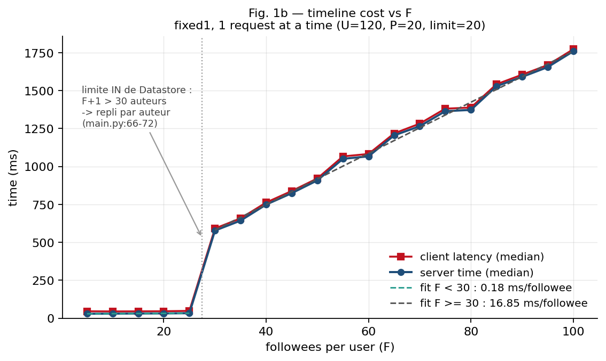
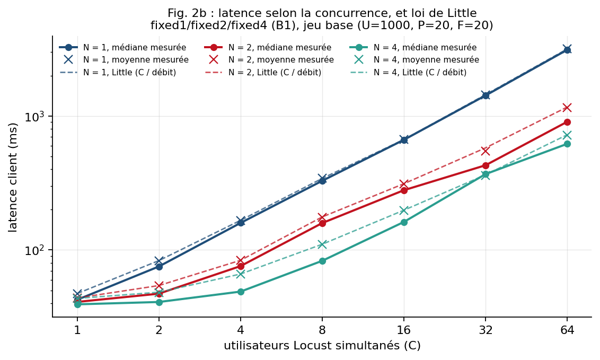
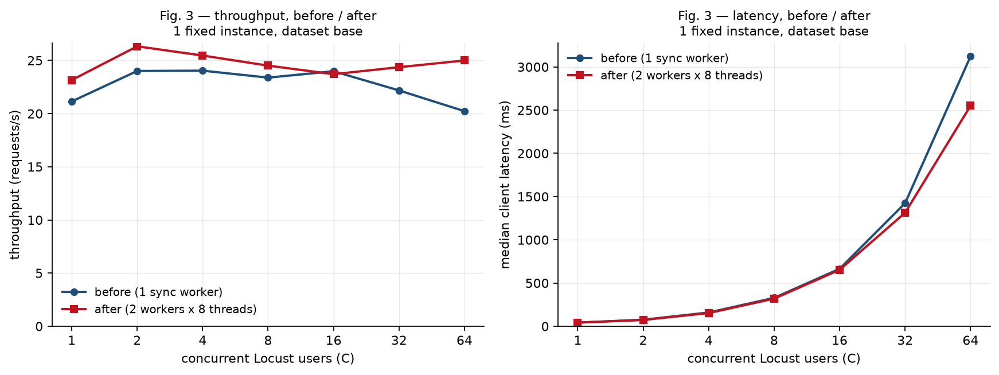

# TinyInsta passe-t-elle à l'échelle ?

Campagne de mesures, projet Données massives et Cloud, édition 2026.
Rendu individuel, Hani Rahmoune, novembre 2026.

- Application déployée (version par défaut) : https://tinyinsta-b.ew.r.appspot.com
- Sujet : [SUJET.md](SUJET.md). Outils fournis : [TOOLS.md](TOOLS.md) (README d'origine du dépôt) et [bench/README.md](bench/README.md).

TinyInsta passe à l'échelle en U et en P : multiplier le nombre d'utilisateurs ou de posts par 100 change le temps serveur de 2 % et 14 %. Elle ne passe pas à l'échelle en F : le temps est stable jusqu'à F = 25, puis il est multiplié par 17,6 à F = 30, parce que Datastore refuse un filtre `IN` de plus de 30 valeurs et que l'application passe alors à une requête par auteur. En ressources, elle passe à l'échelle (2,30 fois le débit avec 2 instances, 3,67 fois avec 4), mais une instance plafonne à environ 24 timelines/s à cause d'une file d'attente d'App Engine située avant l'instance, que l'ajout de threads gunicorn (partie 3) ne fait pas disparaître.

Les 54 journaux Locust sont dans [`raw/`](raw/), et les relevés faits sur le projet dans [`raw/verify/`](raw/verify/). Toutes les figures et tous les CSV se régénèrent avec une commande :

```sh
make figures          # = python scripts/analyze.py
```

---

## 1. Montage

Ces valeurs ont été relevées sur le projet avec [`bench/verify.py`](bench/verify.py).

| Élément | Valeur |
|---|---|
| Projet GCP | `tinyinsta-b` |
| Région App Engine | `europe-west` (europe-west1), URL en `.ew.r.appspot.com` |
| Base | Firestore en mode Datastore (`DATASTORE_MODE`), emplacement `eur3`, créée le 23/11/2026 à 22:12 UTC |
| Index composite | `Post(author ASC, created DESC)`, état `READY` ([`index.yaml`](index.yaml)) |
| Application | `main.py` non modifié ; `python312`, Flask 3.0.0, gunicorn 21.2.0, google-cloud-datastore 2.19.0 ([`requirements.txt`](requirements.txt)) |
| Version par défaut | `20261123t222612` (100 % du trafic, F1, autoscaling jusqu'à 10, [`app.yaml`](app.yaml)) |
| Versions mesurées | `fixed1`, `fixed2`, `fixed4` ([`deploy_fixed.sh`](deploy_fixed.sh), B1, manual scaling) et `fix1` ([`deploy_fix.sh`](deploy_fix.sh), partie 3), toutes en `--no-promote` |
| Client de charge | Cloud Shell, Locust 2.47.0, Python 3.12.3, [`bench/locustfile.py`](bench/locustfile.py) non modifié |
| Alerte budgétaire | `tiny-budget`, 20 USD |
| Orchestration | [`bench/run_part1.sh`](bench/run_part1.sh) pour la partie 1, [`bench/run_sweep.sh`](bench/run_sweep.sh) pour les parties 2 et 3 (même script, donc même protocole), [`Makefile`](Makefile) pour les figures. J'ai utilisé des scripts bash plutôt que Snakemake. |

Chronologie (UTC), d'après les journaux d'audit et les horodatages des journaux bruts ([`raw/verify/version_events.json`](raw/verify/version_events.json)) :

| Version | Déployée | Mesures | Arrêtée |
|---|---|---|---|
| `fixed1` | 24/11 13:52 | partie 1 : 24/11 13:56-14:16, partie 2 (N = 1) : 24/11 14:20-14:51 | 25/11 13:03 |
| `fixed2` | 25/11 13:03 | 25/11 13:04-13:13 | 25/11 13:20 |
| `fixed4` | 25/11 13:20, redéployée à 13:31 (\*) | 25/11 13:32-13:41 | 25/11 13:49 |
| `fix1` | 25/11 13:50 | 25/11 13:54-14:03 | 25/11 14:06 |

(\*) Les journaux d'audit montrent deux déploiements réussis de `fixed4` (13:20-13:21 et 13:31-13:32). Aucune mesure n'a été faite sur le premier : le premier run (`p2_n4_c1`) commence à 13:32:56. Les journaux ne disent pas pourquoi la version a été redéployée.

Les 26 jeux du sujet ont été générés avec [`bench/seed_exact.py`](bench/seed_exact.py), dans l'ordre de [`bench/seed_order.sh`](bench/seed_order.sh). Ils font 394 800 entités au total (`U` entités `User` et `U×P` entités `Post` par jeu). Un écart au sujet : le jeu U = 10 000 s'appelle `u10k` et non `u10000`. Mon premier seeding de `u10000` a échoué (`DeadlineExceeded`) et la suppression du jeu partiel aussi ([`bench/seed_essai1.sh`](bench/seed_essai1.sh), [`bench/supprimer_jeu.py`](bench/supprimer_jeu.py)), donc j'ai refait le jeu sous un nouveau préfixe avec les mêmes paramètres (U = 10 000, P = 20, F = 20). Les entités `u10000_*` restées dans la base ne sont lues par aucune mesure, puisqu'une timeline ne lit que les posts des auteurs du jeu demandé.

Traitement des journaux ([`scripts/analyze.py`](scripts/analyze.py)) : j'enlève les 10 premières secondes de chaque run, les médianes et les moyennes portent sur les réponses `200`, le débit est le nombre de réponses `200` divisé par la durée gardée, et le nombre d'instances est le nombre de valeurs différentes de l'en-tête `X-Instance`.

---

## 2. Résultats

### 2.1 Partie 1 : coût d'une requête

Protocole imposé : version `fixed1` (1 instance B1, manual scaling), une requête à la fois (`-u 1`), runs de 45 s. U ∈ {100, 1 000, 10 000} avec P = 20, F = 20 ; P ∈ {10, 100, 1 000} avec U = 100, F = 20 ; F ∈ {5, 10, …, 100} avec U = 120, P = 20.

#### Hypothèses (écrites avant les mesures, en lisant `main.py`)

`get_timeline` ([`main.py:38-73`](main.py)) lit l'entité `User` par sa clé ([`main.py:43`](main.py)), construit la liste des auteurs `follows = list({*follows, user})` ([`main.py:47`](main.py)), donc F + 1 auteurs, puis lit les 20 posts les plus récents de ces auteurs grâce à l'index `Post(author, created DESC)`.

- U : pas d'effet attendu. La lecture par clé est un accès direct, et la requête ne parcourt que l'index des auteurs suivis.
- P : pas d'effet attendu. L'index est trié par `created DESC` pour chaque auteur, et `limit=20` arrête la lecture après 20 posts.
- F : coût croissant attendu, puisqu'il y a F + 1 plages d'index à lire et à fusionner.
- Un risque dans le code : les requêtes sont dans des `try / except Exception` ([`main.py:51-58`](main.py), [`main.py:60-65`](main.py)). Si Datastore refuse la requête, l'erreur est ignorée et le code passe à un repli qui fait une requête par auteur, l'une après l'autre ([`main.py:66-72`](main.py)), sans aucune erreur HTTP.

#### Figures


*Fig. 1a : temps serveur médian (`Server-Timing`) en fonction de U (P = 20, F = 20) et de P (U = 100, F = 20). Version `fixed1`, 1 requête à la fois. Données : [`figures/fig1a.csv`](figures/fig1a.csv).*



*Fig. 1b : temps serveur médian et latence client médiane en fonction de F (U = 120, P = 20, limit = 20). Version `fixed1`, 1 requête à la fois. Données : [`figures/fig1b.csv`](figures/fig1b.csv).*

#### Interprétation

U : hypothèse confirmée. Le temps serveur médian vaut 30,2, 30,8 et 30,5 ms pour U = 100, 1 000 et 10 000, soit 2 % d'écart au plus pour un facteur 100.

P : hypothèse confirmée. Le temps serveur médian vaut 30,1, 28,8 et 32,8 ms pour P = 10, 100 et 1 000, soit 14 % d'écart au plus, sans tendance nette.

F : le temps augmente bien, mais pas comme prévu. Je m'attendais à une hausse régulière, et la mesure montre une marche :

| F | 5 | 10 | 15 | 20 | 25 | **30** | 50 | 75 | 100 |
|---|---|---|---|---|---|---|---|---|---|
| temps serveur médian (ms) | 29,1 | 29,8 | 30,8 | 31,4 | 32,8 | **577,4** | 908,1 | 1 364,2 | 1 758,9 |
| débit (timelines/s) | 20,8 | 20,8 | 20,7 | 20,5 | 19,9 | **1,6** | 1,0 | 0,7 | 0,6 |

Avec une régression linéaire de chaque côté de la marche (valeurs affichées par `make figures`), la pente est de 0,18 ms par followee jusqu'à F = 25, puis de 16,85 ms par followee à partir de F = 30. Entre F = 25 et F = 30, le temps est multiplié par 17,6.

Pour comprendre la marche, [`bench/verify.py`](bench/verify.py) exécute le vrai `get_timeline` de `main.py` sur la base du projet et compte les requêtes Datastore et les entités lues ([`raw/verify/reads_per_timeline.csv`](raw/verify/reads_per_timeline.csv)) :

| Jeu | F | Auteurs | Chemin exécuté | Requêtes réussies | Requêtes en échec | Entités lues |
|---|---|---|---|---|---|---|
| `base`, `u100`, `u10k`, `p10`, `p100`, `p1000`, `f05`, `f25` | 5 à 25 | 6 à 26 | `IN` ([`main.py:61-64`](main.py)) | 1 | 0 | 21 |
| `f30` | 30 | 31 | repli par auteur ([`main.py:66-72`](main.py)) | 31 | 1 | 621 |
| `f50` | 50 | 51 | repli par auteur | 51 | 1 | 1 021 |
| `f100` | 100 | 101 | repli par auteur | 101 | 1 | 2 021 |

L'erreur ignorée à [`main.py:65`](main.py) est : `InvalidArgument: 400 IN supports up to 30 values. There are 31 values in the IN filter in your query.` J'ai aussi testé directement sur la base : un `IN` à 30 valeurs passe, un `IN` à 31 valeurs échoue ([`raw/verify/in_limit.json`](raw/verify/in_limit.json)). Comme `main.py:47` ajoute l'utilisateur lui-même à la liste, la bascule se fait exactement à F = 30. Les 16,85 ms par followee correspondent au coût de chaque requête en plus dans le repli, puisqu'elles passent l'une après l'autre.

#### Réponses aux questions de la partie 1

Vos hypothèses sont-elles confirmées ? Sinon, qu'aviez-vous manqué ?

Pour U et P, oui. Pour F, j'avais manqué deux choses. D'abord la forme : ce n'est pas une hausse continue mais une marche due à une limite de Datastore (30 valeurs dans un `IN`), qui fait changer le code de chemin sans aucune erreur visible ; en dessous de cette limite, F n'a presque pas d'effet. Ensuite le chemin de code : en lisant `main.py`, je pensais que la requête GQL de [`main.py:52-56`](main.py) était celle exécutée. Elle ne l'est jamais, car `google-cloud-datastore` 2.19.0 n'a pas de méthode `gql` (`hasattr(client, 'gql')` vaut `False`, vérifié par `bench/verify.py`). Le chemin réel est le filtre `IN` de [`main.py:61-64`](main.py), et le repli démarre sur l'exception attrapée à [`main.py:65`](main.py).

Quelle part de la latence client est due au réseau ?

L'écart entre latence client et temps serveur (colonne `client_minus_server_ms` de [`figures/fig1b.csv`](figures/fig1b.csv)) reste entre 12,8 et 17,0 ms pour les 20 valeurs de F, alors que le temps serveur va de 29 à 1 759 ms. Cet écart comprend le réseau et tout ce qui se passe en dehors de `get_timeline` (frontend App Engine, gunicorn, Flask, JSON).

Le journal de requêtes App Engine permet de séparer les deux, à C = 1 et N = 1 ([`raw/verify/pending_time.csv`](raw/verify/pending_time.csv)) : latence client médiane 42,5 ms, latence vue par App Engine (champ `latency`) 35,1 ms, `get_timeline` 29,3 ms. Le trajet entre Cloud Shell et App Engine fait donc environ 7,4 ms, soit 17 % de la latence client, et le reste du traitement dans App Engine environ 5,8 ms. Ce sont des différences de médianes, donc des ordres de grandeur. À F ≥ 30, ces 14 ms font moins de 3 % de la latence.

Combien d'entités Datastore une timeline lit-elle, selon U, P et F ? Coût de 1 million de timelines ?

D'après le code et la mesure ci-dessus :

- si F + 1 ≤ 30 : `1 + min(20, (F+1)·P)`, soit 21 entités quels que soient U, P et F (1 `User` et 20 `Post`) ;
- si F + 1 > 30 : `1 + (F+1)·min(20, P)`, soit 1 + 20 × (F+1) : 621 à F = 30 et 2 021 à F = 100.

Cette formule donne exactement les valeurs mesurées sur les 11 jeux testés par `verify.py`. Appliquée aux 92 485 timelines des journaux qui ont reçu une réponse, elle donne 2 617 485 lectures ; Cloud Monitoring en compte 2 651 340 (lectures par clé et par requête, [`raw/verify/usage.json`](raw/verify/usage.json)), soit 1,3 % de plus, ce qui correspond aux requêtes faites en dehors de Locust (vérifications `curl` des scripts, tests, `verify.py`).

Le prix vient de la grille officielle, lue avec la Cloud Billing Catalog API ([`raw/verify/prices.json`](raw/verify/prices.json)) : SKU `Cloud Datastore Read Ops`, 6 × 10⁻⁷ $ par lecture.

| Cas | Entités par timeline | Lectures pour 1 M de timelines | Coût de 1 M de timelines |
|---|---|---|---|
| tout U (100 à 10 000), tout P (10 à 1 000), F ≤ 29 | 21 | 21 M | 12,60 $ |
| F = 30 | 621 | 621 M | 372,60 $ |
| F = 50 | 1 021 | 1 021 M | 612,60 $ |
| F = 100 | 2 021 | 2 021 M | 1 212,60 $ |

Le détail des 26 jeux est dans [`figures/cost_1M_timelines.csv`](figures/cost_1M_timelines.csv). Le coût ne dépend ni de U ni de P, mais il est 96 fois plus élevé pour un utilisateur qui suit 100 comptes que pour un qui en suit 29.

### 2.2 Partie 2 : capacité

Protocole imposé : versions `fixed1`, `fixed2`, `fixed4` (N = 1, 2, 4 instances B1), jeu `base` (U = 1 000, P = 20, F = 20), C ∈ {1, 2, 4, 8, 16, 32, 64}, runs de 75 s, une seule version déployée à la fois (voir la chronologie au § 1).

#### Hypothèse (écrite avant les mesures)

[`app.yaml:2`](app.yaml) lance `gunicorn -b :$PORT main:app`, sans `--workers` ni `--threads`, donc avec un seul worker synchrone qui traite une requête à la fois. J'en déduisais trois choses :

1. une instance sature dès C = 1, à environ `1 / temps de service` ;
2. au-delà, les requêtes attendent et la latence suit la loi de Little ;
3. le débit maximal est proportionnel à N, puisque les instances ne partagent que Datastore.

Les journaux de `fixed1` confirment cette configuration : `Using worker: sync` et un seul `Booting worker` par démarrage ([`raw/verify/gunicorn_fixed1.json`](raw/verify/gunicorn_fixed1.json)).

#### Figures


*Fig. 2a : débit en fonction de C, une courbe par N. Jeu `base` (U = 1 000, P = 20, F = 20). Données : [`figures/fig2a.csv`](figures/fig2a.csv).*



*Fig. 2b : latence client médiane (trait plein) et prédiction de Little `C / débit` (pointillés), une couleur par N. Jeu `base` (U = 1 000, P = 20, F = 20). Données : [`figures/fig2b.csv`](figures/fig2b.csv).*

#### Interprétation

| N | 1 | 2 | 4 |
|---|---|---|---|
| débit maximal (timelines/s) | 24,0 (C = 4) | 55,3 (C = 32) | 88,3 (C = 64) |
| rapport à N = 1 | 1 | 2,30 | 3,67 |
| débit maximal par instance | 24,0 | 27,7 | 22,1 |
| temps serveur médian, toutes valeurs de C | 29,3 à 32,9 ms | 27,6 à 29,3 ms | 26,0 à 28,7 ms |

Où se situe le point de saturation pour chaque N ?

Avec N = 1, le débit vaut 21,1 timelines/s à C = 1, puis reste entre 20,2 et 24,0 de C = 2 à C = 64. Avec N = 2 et N = 4, le plafond est atteint vers C = 32 (55,3 puis 54,9 pour N = 2, 87,9 puis 88,3 pour N = 4). Ma prédiction de saturation dès C = 1 est presque juste pour N = 1 : à C = 1, l'instance est déjà à 88 % de son plafond, qu'elle atteint à C = 2.

Quelle est la capacité d'une instance, et qu'est-ce qui la limite ?

Une instance sert environ 24 timelines/s. Le temps passé dans `get_timeline` ne change pas avec la charge (29,3 ms à C = 1, 32,9 ms à C = 64), alors que la latence client passe de 42,5 à 3 121,6 ms. Le temps en plus est donc de l'attente.

Le journal de requêtes App Engine montre où se fait cette attente ([`raw/verify/pending_time.csv`](raw/verify/pending_time.csv)). Son champ `pendingTime` est défini par Google comme *« Time this request spent in the pending request queue »* ([`request_log.proto`](https://github.com/googleapis/googleapis/blob/master/google/appengine/logging/v1/request_log.proto)). Pour `fixed1`, dès C = 2, 96 à 100 % des requêtes passent par cette file, et elles y passent la plus grande partie de leur temps :

| C | 2 | 4 | 8 | 16 | 32 | 64 |
|---|---|---|---|---|---|---|
| latence App Engine médiane (ms) | 68,1 | 150,5 | 319,1 | 656,3 | 1 416,6 | 3 101,1 |
| `pendingTime` médian (ms) | 26,2 | 107,3 | 276,2 | 612,4 | 1 368,9 | 3 053,2 |
| différence (ms) | 41,9 | 43,2 | 42,9 | 43,9 | 47,7 | 47,9 |

La différence, 42 à 48 ms, est le temps que l'instance passe sur chaque requête : environ 30 ms dans `get_timeline` et le reste dans le traitement de la requête. Elle colle au plafond mesuré, puisque 1 / 41,9 ms donne 23,9 timelines/s. Une instance est donc limitée parce qu'App Engine garde les requêtes dans sa file et les lui donne une par une, ce qui va avec l'indice du sujet (un seul worker synchrone). La partie 3 montre que ce n'est pas tout.

La loi de Little est-elle vérifiée au-delà de la saturation ?

Oui. La loi de Little relie C à la latence moyenne (`moyenne = C / débit`). Sur la moyenne, l'écart est sous 1 % pour 20 des 21 points, et de 5,8 % pour N = 2, C = 32 (colonne `little_vs_mean_pct` de [`figures/fig2b.csv`](figures/fig2b.csv)). Pour N = 1 :

| C | 1 | 2 | 4 | 8 | 16 | 32 | 64 |
|---|---|---|---|---|---|---|---|
| latence moyenne mesurée (ms) | 47,2 | 83,2 | 166,5 | 342,2 | 667,5 | 1 441,6 | 3 169,2 |
| prédiction `C / débit` (ms) | 47,3 | 83,3 | 166,4 | 342,1 | 667,1 | 1 442,8 | 3 163,7 |
| latence médiane mesurée (ms) | 42,5 | 75,3 | 159,1 | 328,3 | 664,3 | 1 423,4 | 3 121,6 |

Ce résultat est normal : Locust tourne en boucle fermée sans temps d'attente entre deux requêtes, donc il y a toujours exactement C requêtes en cours. Ça montre surtout que les mesures de débit et de latence sont cohérentes. Sur la médiane, qui est ce que trace la figure, l'écart à Little reste faible pour N = 1 (0,4 à 1,4 % pour C ≥ 16), mais monte à 29-35 % pour N = 2 à C = 32 et 64 (colonne `little_vs_median_pct`) : avec plusieurs instances, certaines requêtes attendent beaucoup plus longtemps, et la moyenne s'éloigne de la médiane.

Passer de 1 à 4 instances multiplie-t-il le débit maximal par 4 ? Sinon, où est le goulot ?

Presque : 3,67 fois pour N = 4, et 2,30 fois pour N = 2. D'après la définition du sujet (« multiplié par environ k »), les ressources passent à l'échelle. Datastore n'est pas le goulot, puisque le temps serveur n'augmente pas avec N (il est même un peu plus bas à N = 4). Les 8 % qui manquent pour atteindre 4 sont du même ordre que l'écart d'une instance à l'autre (22,1 à 27,7 timelines/s selon le déploiement), ce qui explique aussi que N = 2 fasse un peu plus que 2 fois. Je ne peux donc pas les attribuer à un goulot précis. À N = 4 et C = 64, la file d'App Engine est toujours là (`pendingTime` médian de 509 ms sur 563 ms de latence) : chaque instance reste saturée.

### 2.3 Partie 3 : corriger et re-mesurer

Goulot choisi : la capacité d'une instance (partie 2).

Hypothèse (écrite avant les mesures) : si la limite vient du worker synchrone unique, il suffit de laisser l'instance traiter plusieurs requêtes en même temps. Comme une timeline passe une partie de son temps à attendre Datastore, ces requêtes se chevaucheraient et le débit augmenterait nettement.

Correction : la version `fix1` ([`deploy_fix.sh`](deploy_fix.sh)) est identique à `fixed1` (B1, manual scaling, 1 instance, `--no-promote`), sauf une ligne :

```
entrypoint: gunicorn -b :$PORT --workers 2 --threads 8 main:app
```

Les journaux confirment que cette configuration a bien démarré : `Using worker: gthread` et deux `Booting worker` ([`raw/verify/gunicorn_fix1.json`](raw/verify/gunicorn_fix1.json)). Le protocole est celui de la partie 2 pour N = 1 : même script [`bench/run_sweep.sh`](bench/run_sweep.sh), mêmes valeurs de C, même jeu, même durée.



*Fig. 3 : débit et latence avant (`fixed1`) et après (`fix1`), N = 1, jeu `base` (U = 1 000, P = 20, F = 20). Données : [`figures/fig3.csv`](figures/fig3.csv).*

#### Interprétation : hypothèse réfutée

| C | 1 | 2 | 4 | 8 | 16 | 32 | 64 |
|---|---|---|---|---|---|---|---|
| débit avant (timelines/s) | 21,1 | 24,0 | 24,0 | 23,4 | 24,0 | 22,2 | 20,2 |
| débit après (timelines/s) | 23,2 | 26,3 | 25,5 | 24,5 | 23,7 | 24,4 | 25,0 |
| écart | +9,5 % | +9,7 % | +5,9 % | +4,8 % | −1,2 % | +9,9 % | +23,6 % |
| temps serveur médian avant / après (ms) | 29,3 / 27,7 | 29,9 / 28,1 | 30,4 / 29,5 | 30,7 / 30,0 | 30,3 / 31,4 | 30,3 / 29,8 | 32,9 / 29,2 |

Le débit maximal passe de 24,0 à 26,3 timelines/s (+9,5 %), mais ce gain ne vient pas de la correction : à C = 1 il n'y a qu'une requête à la fois, donc les threads ne servent à rien, et l'écart y est déjà de +9,5 %. C'est la différence entre deux instances déployées à des moments différents, comme les 22,1 à 27,7 timelines/s par instance vus en partie 2. Le seul écart plus grand est à C = 64 (25,0 contre 20,2 timelines/s, 2 550 contre 3 122 ms de latence médiane), sur un seul run.

Le journal de requêtes de `fix1` explique pourquoi ça ne marche pas ([`raw/verify/pending_time.csv`](raw/verify/pending_time.csv)) : la file d'attente est toujours là. À C = 64, sur 2 537 ms de latence App Engine médiane, 2 494 ms sont passées dans la file, contre 3 053 sur 3 101 ms avec `fixed1`, et le temps serveur reste vers 28-31 ms pour tous les C. Les 16 threads ne reçoivent donc pas plus de requêtes en même temps qu'avant : l'attente se fait avant l'instance, là où la configuration de gunicorn ne change rien. Je n'ai pas trouvé pourquoi App Engine ne donne pas plus de requêtes simultanées à une instance B1 en manual scaling ; il faudrait refaire la mesure en changeant le mode de scaling ou la classe d'instance.

Ce que coûte la correction :

- complexité : une seule ligne de configuration, mais le `datastore.Client()` global ([`main.py:10`](main.py)) est maintenant partagé par 8 threads par processus, et je n'ai pas vérifié que c'est sans risque ;
- argent : même classe et même nombre d'instances, donc même prix à l'heure (0,05 $ par heure d'instance B, [`raw/verify/prices.json`](raw/verify/prices.json)) ; `fix1` a tourné 0,27 h ;
- mémoire : deux processus Python au lieu d'un, non mesuré ;
- cohérence des données : aucun effet, le chemin mesuré ne fait que lire.

Au final, la correction n'apporte pas de gain démontré, donc je ne la garderais pas.

Pour le goulot de la partie 1, la correction la plus simple serait de découper la liste d'auteurs en paquets de 30 au plus, soit une requête `IN` par paquet (4 requêtes à F = 100 au lieu de 101), puis de fusionner les résultats. Je ne l'ai pas déployée ni mesurée.

---

## 3. Tableau des verdicts

| Dimension | Passe à l'échelle ? | Jusqu'où ? | Pourquoi (mécanisme) | Preuve |
|---|---|---|---|---|
| Utilisateurs (U) | Oui | Mesuré jusqu'à U = 10 000 : 30,2 puis 30,5 ms | Lecture du `User` par clé ([`main.py:43`](main.py)) et requête sur l'index `Post(author, created DESC)` limitée aux auteurs suivis. Une timeline lit 21 entités quel que soit U (mesuré). | Fig. 1a, [`reads_per_timeline.csv`](raw/verify/reads_per_timeline.csv) |
| Posts par utilisateur (P) | Oui | Mesuré jusqu'à P = 1 000 : 28,8 à 32,8 ms | `ORDER BY created DESC` sur l'index et `limit=20` : 20 posts lus quel que soit P (mesuré). | Fig. 1a, [`reads_per_timeline.csv`](raw/verify/reads_per_timeline.csv) |
| Followees (F) | Non | Stable jusqu'à F = 25 (32,8 ms), 17,6 fois plus à F = 30, puis +16,85 ms par followee | Au-delà de 30 auteurs, Datastore refuse l'`IN` (`IN supports up to 30 values`, mesuré). L'erreur est ignorée ([`main.py:65`](main.py)) et le repli fait F + 1 requêtes l'une après l'autre ([`main.py:66-72`](main.py)) : on passe de 21 à 1 + 20 × (F+1) entités lues. | Fig. 1b, [`in_limit.json`](raw/verify/in_limit.json) |
| Instances (N) | Oui (environ k) | 2,30 fois à N = 2, 3,67 fois à N = 4 | Les instances sont indépendantes et Datastore ne sature pas (temps serveur constant). Chaque instance plafonne à environ 24 timelines/s, parce qu'App Engine fait attendre les requêtes dans sa file avant l'instance (`pendingTime`) ; ajouter des threads gunicorn n'y change rien. | Fig. 2a, Fig. 3, [`pending_time.csv`](raw/verify/pending_time.csv) |

---

## 4. Validité

### 4.1 Combien d'instances ont réellement servi chaque mesure ? Est-ce celles attendues ?

Je les compte avec les valeurs différentes de l'en-tête `X-Instance`, run par run (colonnes `instances_observed` et `instance_ids` de [`figures/summary.csv`](figures/summary.csv)) :

| Mesures | Attendu | Observé, dans chaque run |
|---|---|---|
| Partie 1 (26 runs) | 1 | 1, toujours la même instance (`00e8a408bd06…`) |
| Partie 2, N = 1 (7 runs) | 1 | 1, la même instance que la partie 1 |
| Partie 2, N = 2 (7 runs) | 2 | 2, toujours les deux mêmes |
| Partie 2, N = 4 (7 runs) | 4 | 4, toujours les quatre mêmes, y compris à C = 1 |
| Partie 3 (7 runs) | 1 | 1 (`00e8a408bddf…`) |

Chaque mesure a été servie par le nombre d'instances attendu. Le journal de requêtes App Engine donne les mêmes nombres pour les parties 2 et 3 (colonne `instances` de [`raw/verify/pending_time.csv`](raw/verify/pending_time.csv)).

### 4.2 Vos runs sont-ils indépendants ? L'ordre des mesures influence-t-il les résultats ?

Pas complètement, et je n'ai pas testé l'effet de l'ordre.

- Les runs d'une même version s'enchaînent sur les mêmes instances, sans redémarrage. Pour `fixed1`, gunicorn a démarré le 24/11 à 13:52:50, puis le 25/11 à 02:08 et 09:22, donc après la fin de ses mesures ([`raw/verify/gunicorn_fixed1.json`](raw/verify/gunicorn_fixed1.json)) : les 33 runs de `fixed1` ont été servis par le même processus.
- Les runs ont été faits dans un ordre fixe (U, puis P, puis F ; C croissant), pas dans un ordre aléatoire. Pour N = 1, C = 32 et C = 64 ont été lancés 21 minutes après C = 16, parce que le script s'était arrêté.
- Chaque point n'a été mesuré qu'une fois, donc je n'ai pas de mesure directe de la dispersion. Deux indices la placent autour de 10 % : les sept runs de la partie 1 avec F = 20 (`u100`, `base`, `u10k`, `p10`, `p100`, `p1000`, `f20`) donnent entre 28,8 et 32,8 ms, et à C = 1, `fixed1` et `fix1` diffèrent de 9,5 % en débit alors que les threads ne peuvent rien changer sans concurrence.

Les effets principaux (17,6 fois pour F, 3,67 fois pour N) sont bien au-dessus de ce bruit. Les écarts de moins de 10 %, dont ceux de la partie 3, ne veulent rien dire.

### 4.3 Quelle part de la latence est due au réseau ?

Voir le § 2.1. L'écart entre latence client et temps serveur vaut 12,8 à 17,0 ms en partie 1 et ne dépend pas de F. À C = 1, le journal App Engine le sépare en environ 7,4 ms de trajet entre Cloud Shell et App Engine (17 % des 42,5 ms de latence client) et environ 5,8 ms de traitement dans App Engine en dehors de `get_timeline`. Une fois l'instance saturée, la latence est surtout de l'attente dans la file d'App Engine (§ 2.2), et le réseau ne pèse plus rien (moins de 1 % à C = 64, N = 1).

### 4.4 Qu'avez-vous compté comme un échec ? Quels codes HTTP avez-vous observés ?

Tout ce qui n'est pas un `200`. Locust note `STATUS = 0` quand une requête n'a reçu aucune réponse HTTP, avec l'exception côté client dans la colonne `ERROR`.

Sur les 92 547 requêtes de la campagne (colonnes `http_codes_all` et `client_errors_all` de [`figures/summary.csv`](figures/summary.csv)), je n'ai vu que des `200` et des `0`, aucune réponse 4xx ou 5xx. Il y a 62 requêtes `0` (0,07 %), dans 15 runs, toutes à C ≥ 4 : 28 `ConnectionRefusedError` et 34 `gaierror` (échec de résolution DNS). 61 d'entre elles tombent dans les 10 premières secondes, quand Locust lance ses C utilisateurs, et sont donc enlevées par l'analyse. Il en reste une seule dans les données analysées (`p2_n2_c16`, 1 sur 3 303).

Pour la partie 1, il n'y a aucune erreur à F ≥ 30, alors que le service y est jusqu'à 54 fois plus lent qu'à F = 25. L'erreur Datastore existe (`InvalidArgument 400`), mais `main.py:65` l'ignore, donc les codes HTTP ne la montrent pas.

### 4.5 Avez-vous vérifié que votre mesure exerce bien le chemin de code que vous croyez ?

Oui, et c'est cette vérification qui a corrigé ma lecture du code (§ 2.1). Avec [`bench/verify.py`](bench/verify.py), j'ai vérifié quatre choses :

1. Le chemin de code : le vrai `get_timeline` a été lancé sur chaque type de jeu en comptant les requêtes et les entités ([`raw/verify/reads_per_timeline.csv`](raw/verify/reads_per_timeline.csv)). La branche GQL ([`main.py:52-56`](main.py)) ne s'exécute jamais (`hasattr(client, 'gql')` vaut `False`). Jusqu'à F = 25, c'est une seule requête `IN` ([`main.py:61-64`](main.py)) ; à partir de F = 30, c'est le repli par auteur ([`main.py:66-72`](main.py)), avec le message d'erreur de Datastore.
2. La limite : un `IN` à 30 valeurs passe, à 31 il échoue ([`raw/verify/in_limit.json`](raw/verify/in_limit.json)).
3. La configuration déployée : `Using worker: sync` pour `fixed1`, `Using worker: gthread` avec deux workers pour `fix1` ([`raw/verify/gunicorn_fixed1.json`](raw/verify/gunicorn_fixed1.json), [`raw/verify/gunicorn_fix1.json`](raw/verify/gunicorn_fix1.json)).
4. Le volume de travail : Cloud Monitoring compte 2 651 340 lectures pendant la campagne, à 1,3 % de ce que donne le chemin de code pour les 92 485 timelines des journaux (§ 2.1).

### 4.6 Combien votre campagne a-t-elle coûté (lectures, écritures, heures d'instance) ?

Voir le § 5.

---

## 5. Coût de la campagne

Quantités consommées, mesurées par Cloud Monitoring ([`raw/verify/usage.json`](raw/verify/usage.json), [`figures/campaign_cost.csv`](figures/campaign_cost.csv)) :

| Poste | Quantité |
|---|---|
| Lectures d'entités par clé | 93 007 |
| Lectures d'entités par requête | 2 558 333 |
| Lectures *keys-only* (suppressions de jeux) | 50 601 |
| Écritures d'entités | 610 392 |
| Suppressions d'entités | 39 599 |
| Heures d'instance B1 : `fixed1` / `fixed2` / `fixed4` / `fix1` | 23,20 / 0,60 / 1,89 / 0,27 h (total 25,96 h) |
| Heures d'instance F1 : version par défaut | 0,25 h |

Montant facturé, d'après la page Facturation (compte « Billing Account for Education », dont `tinyinsta-b` est le seul projet, du 1er au 26 novembre 2026) :

| Coût | Économies (crédits éducation) | Total payé |
|---|---|---|
| 3,12 $ | −3,12 $ | 0,00 $ |

`fixed1` est restée démarrée 23,2 heures, dont 22,73 heures après la fin de ses mesures (24/11 14:51) et avant son arrêt (25/11 13:03), alors que le § 9 du sujet demande d'arrêter chaque version `fixedN` dès la fin de ses mesures.

---

## Annexe : reproduire la campagne

```sh
pip install -r bench/requirements.txt -r scripts/requirements.txt

# 1. les 26 jeux de données (une seule fois)
./bench/seed_order.sh

# 2. partie 1 + partie 2 (N=1), sur une seule version
./deploy_fixed.sh 1
URL=https://fixed1-dot-<projet>.ew.r.appspot.com ./bench/run_part1.sh
URL=https://fixed1-dot-<projet>.ew.r.appspot.com N=1 ./bench/run_sweep.sh
gcloud app versions stop fixed1

# 3. partie 2, N=2 puis N=4 (une version à la fois, arrêtée aussitôt)
./deploy_fixed.sh 2 && URL=https://fixed2-dot-<projet>.ew.r.appspot.com N=2 ./bench/run_sweep.sh
gcloud app versions stop fixed2
./deploy_fixed.sh 4 && URL=https://fixed4-dot-<projet>.ew.r.appspot.com N=4 ./bench/run_sweep.sh
gcloud app versions stop fixed4

# 4. partie 3
./deploy_fix.sh
URL=https://fix1-dot-<projet>.ew.r.appspot.com N=1 TAG=p3 ./bench/run_sweep.sh
gcloud app versions stop fix1

# 5. relevés sur le projet (chemin de code, limite IN, journaux,
#    Cloud Monitoring, grille tarifaire) -> raw/verify/
python3 bench/verify.py

# 6. toutes les figures et tous les CSV
make figures
```
