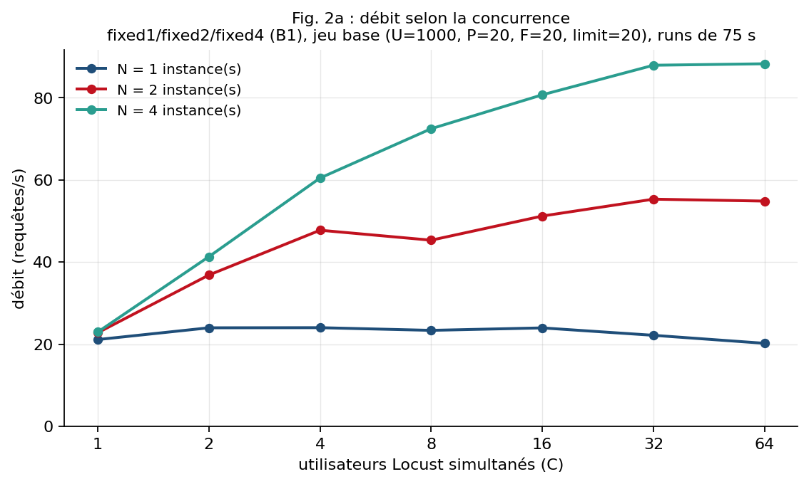

# TinyInsta passe-t-elle à l'échelle ? — Campagne de mesures 2026

> **TODO rendu** — remplacer les `TODO` ci-dessous, puis déposer sur Madoc :
> URL du dépôt + URL de l'application (version par défaut, maintenue en ligne
> jusqu'à la fin de la correction).

- **Application mesurée** : TODO `https://<PROJET>.<REGION>.r.appspot.com`
- **Dépôt** : TODO
- **Sujet** : [SUJET.md](SUJET.md) · **Outils du dépôt** : [TOOLS.md](TOOLS.md), [bench/README.md](bench/README.md)

Toutes les figures et tous les CSV de ce rapport se régénèrent par une seule
commande, à partir des journaux bruts versionnés dans [`raw/`](raw/) :

```sh
make figures          # = python scripts/analyze.py
```

---

## 1. Montage

| Élément | Valeur |
|---|---|
| Projet GCP | TODO |
| Région App Engine | TODO (`gcloud app describe --format='value(locationId)'`) |
| Base Firestore | mode Datastore, emplacement TODO, `concurrencyMode` TODO |
| Index composite | `Post(author, created DESC)` — `index.yaml` |
| Classe d'instance | `F1` (version par défaut) / `B1` (versions `fixedN`, même CPU et mémoire) |
| Versions déployées | `default` (autoscaling ≤ 10), `fixed1`, `fixed2`, `fixed4`, `fix1` (partie 3) |
| Client de charge | Locust TODO version, exécuté depuis **Cloud Shell**, région TODO |
| Dates de la campagne | TODO |
| Jeux de données | 26 préfixes, ~400 000 entités (§2 du sujet) |

Les entités `Post` et `User` sont générées par `bench/seed_exact.py` : `U`
utilisateurs, **exactement** `P` posts chacun, **exactement** `F` followees
chacun, dates réparties sur 30 jours.

---

## 2. Résultats

### 2.1 Partie 1 — Coût d'une requête

**Protocole.** Version `fixed1` (manual scaling, 1 instance), `-u 1` : une seule
requête en vol à tout instant, donc ni autoscaling ni concurrence. 26 runs de
45 s. Les 10 premières secondes de chaque run sont écartées (démarrage à froid
de l'instance, remplissage des caches). Latence client mesurée par Locust, temps
serveur lu dans l'en-tête `Server-Timing: timeline;dur=…` produit par
`main.py:158`.

#### Hypothèses

Lecture de `get_timeline` (`main.py:38-73`). Le chemin nominal fait deux choses :

1. `client.get(client.key('User', user))` (`main.py:43`) — une **lecture par
   clé**, donc à coût constant quel que soit le nombre d'utilisateurs stockés.
2. `SELECT * FROM Post WHERE author IN @authors ORDER BY created DESC` avec
   `limit=20` (`main.py:53-55`), servie par l'index composite
   `Post(author, created DESC)` de `index.yaml`.

- **Facteur U — hypothèse : aucun effet.** Une lecture par clé est un accès
  direct ; la requête, elle, n'est indexée que sur `author`, et les auteurs
  demandés sont les mêmes quel que soit U. Multiplier U par 100 ne change ni le
  nombre d'entrées d'index parcourues ni le nombre d'entités lues. En termes du
  cours : les données sont *shardées*, et la requête ne touche que les shards
  des auteurs suivis. **Prédiction : courbe plate.**

- **Facteur P — hypothèse : aucun effet.** Pour chaque auteur, l'index est trié
  par `created DESC` : le moteur se positionne sur la première entrée de
  l'auteur et s'arrête après au plus `limit` entrées. Qu'un auteur ait 10 ou
  1000 posts ne change pas le nombre d'entrées lues, seulement la taille de
  l'index. **Prédiction : courbe plate.**

- **Facteur F — hypothèse : coût linéaire en F.** C'est le point clé. Datastore
  ne sait pas exécuter un `IN` en une seule passe : il le **normalise en une
  disjonction**, c'est-à-dire une sous-requête par auteur, puis fusionne les
  résultats triés. Avec `follows = list({*follows, user})` (`main.py:47`), il y
  a `F+1` auteurs, et il faut lire jusqu'à `limit` entrées par auteur pour
  garantir que la fusion rende bien les 20 plus récentes. D'où une borne haute
  de **`1 + (F+1) × 20` entités lues pour afficher 20 posts** (modèle tabulé
  dans [`figures/cost_model.csv`](figures/cost_model.csv)). **Prédiction :
  temps serveur affine en F**, et c'est un goulot *de forme de requête*, pas de
  volume de données — exactement le « vous avez partitionné les données mais pas
  les accès » du cours.

- **Risque de changement de chemin de code.** Datastore limite le nombre de
  disjonctions après normalisation (100). À F=100, il y a 101 auteurs. Si la
  limite est franchie, l'exception est **avalée silencieusement**
  (`except Exception: pass`, `main.py:57`) et l'exécution tombe dans le repli
  final (`main.py:66-72`) : une requête **par auteur**, séquentiellement, puis
  un tri côté application. Aucun code d'erreur HTTP ne le signale. À vérifier
  explicitement (cf. §4.5).

#### Figures


*Fig. 1a — temps serveur médian en fonction de U (P=20, F=20) et de P (U=100,
F=20). Données : [`figures/fig1a.csv`](figures/fig1a.csv).*


*Fig. 1b — temps serveur médian et latence client médiane en fonction de F
(U=120, P=20, limit=20). Données : [`figures/fig1b.csv`](figures/fig1b.csv).*

#### Interprétation

TODO — confronter chaque hypothèse aux courbes. Points à traiter :

- U et P : la courbe est-elle plate ? Dans quelle amplitude de bruit ?
- **Contrôle croisé gratuit** : F=20 est mesuré quatre fois de façon
  indépendante — `u100` (U=100), `base` (U=1000), `u10000` (U=10000) et `f20`
  (U=120). Si U n'a vraiment aucun effet, ces quatre points doivent coïncider.
  Comparer les valeurs et commenter l'écart.
- F : la pente mesurée (ms par followee, annotée sur la figure) est-elle
  compatible avec « +20 entités lues par followee » ?
- Y a-t-il une rupture de pente à F élevé (repli `main.py:66-72`) ?

#### Questions du sujet

1. **Hypothèses confirmées ?** TODO
2. **Part réseau de la latence client ?** TODO — `network_ms_median` dans
   `figures/fig1b.csv` est la différence latence client − temps serveur ; elle
   contient le réseau Cloud Shell → App Engine, le frontend App Engine et le
   coût Flask/gunicorn hors `get_timeline`.
3. **Entités lues et coût d'un million de timelines ?** TODO — modèle
   `1 + (F+1) × limit` dans [`figures/cost_model.csv`](figures/cost_model.csv).
   Confirmer le tarif courant de Datastore avant de conclure, et confronter le
   modèle aux lectures réellement facturées (page Facturation).

### 2.2 Partie 2 — Capacité

**Protocole.** Versions `fixed1`, `fixed2`, `fixed4`, jeu `base`
(U=1000, P=20, F=20), C ∈ {1, 2, 4, 8, 16, 32, 64}, runs de 75 s, une version
déployée à la fois et arrêtée avant la suivante. Le nombre d'instances ayant
réellement répondu est compté à partir de l'en-tête `X-Instance`.

#### Hypothèse

L'application est lancée par `app.yaml:2` :

```
entrypoint: gunicorn -b :$PORT main:app
```

Ni `--workers`, ni `--threads`. Le défaut de gunicorn est **un seul worker
synchrone, mono-thread** : une instance ne traite **qu'une requête à la fois**,
alors que `get_timeline` passe l'essentiel de son temps à *attendre* Datastore,
CPU inoccupé.

- **Prédiction 1** : le débit d'une instance sature dès C=1, à environ
  `1 / temps_de_service` (soit ~`1000 / Server-Timing` req/s).
- **Prédiction 2** : au-delà, la concurrence ne fait que remplir une file. La
  loi de Little (`latence ≈ C / débit`) doit donc être vérifiée *d'autant mieux*
  que C est grand, et la latence croître linéairement en C.
- **Prédiction 3** : le débit maximal doit être ~proportionnel à N, puisque les
  instances sont indépendantes et que Datastore est très loin de sa capacité.
- **Lecture « cours »** : la fraction séquentielle α de la loi d'Amdahl vaut 1
  *à l'intérieur* d'une instance — élasticité sans scalabilité (slide 122).

#### Figures



*Fig. 2a — débit en fonction de C, une courbe par N.
Données : [`figures/fig2a.csv`](figures/fig2a.csv).*


*Fig. 2b — latence médiane en fonction de C (trait plein) et prédiction de la
loi de Little `C / débit` (pointillés).
Données : [`figures/fig2b.csv`](figures/fig2b.csv).*

#### Questions du sujet

1. **Point de saturation et capacité d'une instance ?** TODO
2. **Loi de Little vérifiée au-delà de la saturation ?** TODO — comparer
   `client_ms_median` et `little_latency_ms` dans `figures/fig2b.csv`.
3. **1 → 4 instances donne-t-il ×4 ?** TODO — si non, chercher le goulot
   (file côté frontend App Engine, client Locust, Datastore, réseau).

### 2.3 Partie 3 — Corriger et re-mesurer

**Goulot choisi** : la sérialisation des requêtes dans une instance
(partie 2), et non le coût en F (partie 1).

**Correction** : `deploy_fix.sh` déploie la version `fix1`, identique à `fixed1`
(B1, manual scaling, 1 instance) à une ligne près —
`entrypoint: gunicorn -b :$PORT --workers 2 --threads 8 main:app`. Le chemin
mesuré étant dominé par l'attente réseau de Datastore, des threads suffisent à
recouvrir cette attente ; le GIL n'est pas un obstacle pour de l'I/O.
**Même protocole que la partie 2, N=1.**


*Fig. 3 — débit et latence avant / après, 1 instance fixe, jeu `base`.
Données : [`figures/fig3.csv`](figures/fig3.csv).*

#### Interprétation et coût de la correction

TODO — traiter :

- gain en débit maximal, et nouveau point de saturation ;
- effet sur la latence à faible C (devrait être nul : on ne rend pas une requête
  isolée plus rapide, on en sert plusieurs) ;
- **ce que ça coûte** : mémoire (B1/F1 = 256 Mo pour 2 workers), un
  `datastore.Client()` défini au niveau module (`main.py:10`) désormais partagé
  entre threads, pression accrue sur Datastore, aucune garantie supplémentaire
  perdue côté cohérence (lectures seules) ;
- **alternative non mesurée, à discuter** : *fan-out on write* / timeline
  matérialisée (`feeds_home` shardée par `user_id`, cours slides 106 et 124).
  La lecture deviendrait O(1) en F au lieu de O(F) — c'est la vraie réponse au
  goulot de la partie 1. Coût : amplification des écritures (un post = autant
  d'écritures que de followers), stockage, et surtout **cohérence** : le fan-out
  ne doit pas être fait dans une transaction multi-shard (cours slide 127) mais
  en asynchrone via Pub/Sub avec *outbox* et consommateurs idempotents (slides
  170-173), donc cohérence à terme sur la timeline.

---

## 3. Tableau des verdicts

| Dimension | Passe à l'échelle ? | Jusqu'où ? | Pourquoi (mécanisme) | Preuve |
|---|---|---|---|---|
| Utilisateurs (U) | TODO | TODO | TODO | Fig. 1a |
| Posts par utilisateur (P) | TODO | TODO | TODO | Fig. 1a |
| Followees (F) | TODO | TODO | TODO | Fig. 1b |
| Instances (N) | TODO | TODO | TODO | Fig. 2a |

---

## 4. Validité

**4.1 Combien d'instances ont réellement servi chaque mesure ?**
TODO — colonne `instances_observed` de
[`figures/summary.csv`](figures/summary.csv), comptée sur les valeurs distinctes
de `X-Instance`. Signaler les mesures où le compte observé est inférieur à N.

**4.2 Les runs sont-ils indépendants ? L'ordre compte-t-il ?**
TODO — ordre d'exécution, écart des 10 premières secondes, instance jamais
redémarrée entre deux runs d'une même version, éventuelle répétition d'un point
(`_r2`) pour estimer la dispersion.

**4.3 Part de la latence due au réseau ?**
TODO — `client_ms_median − server_ms_median`, et d'où tourne le client.

**4.4 Qu'avez-vous compté comme un échec ? Quels codes HTTP ?**
Toute réponse dont `STATUS != 200` est un échec ; `STATUS = 0` signale une
requête qui n'a pas abouti (erreur réseau, colonne `ERROR`). Codes observés :
TODO — colonne `http_codes` de `figures/summary.csv`.

**4.5 La mesure exerce-t-elle bien le chemin de code attendu ?**
TODO — point critique : vérifier que le `IN` GQL (`main.py:53`) est bien
utilisé, et qu'on ne bascule pas silencieusement dans les replis
(`main.py:59-72`) à F élevé. Méthode : chercher une rupture de pente sur la
fig. 1b, et/ou instrumenter temporairement `get_timeline` pour exposer le chemin
emprunté dans un en-tête.

**4.6 Combien a coûté la campagne ?**
TODO — voir §5.

---

## 5. Coût de la campagne

| Poste | Quantité | Coût |
|---|---|---|
| Écritures (seeding, ~400 000 entités) | TODO | TODO |
| Lectures (toutes les mesures) | TODO | TODO |
| Heures d'instance (`fixed1/2/4`, `fix1`, défaut) | TODO | TODO |
| Stockage | TODO | TODO |
| **Total** | | **TODO** |

Chiffres relevés sur la page Facturation du projet le TODO.

---

## Annexe — Reproduire la campagne

```sh
pip install -r bench/requirements.txt -r scripts/requirements.txt

# 1. jeux de données (26 préfixes, une seule fois)
P=<projet> ./bench/seed_all.sh

# 2. partie 1 + partie 2 (N=1) sur une seule version
./deploy_fixed.sh 1
URL=$(gcloud app versions describe fixed1 --service default --format='value(versionUrl)')
URL=$URL ./bench/run_part1.sh
URL=$URL N=1 ./bench/run_sweep.sh
gcloud app versions stop fixed1

# 3. partie 2, N=2 puis N=4
./deploy_fixed.sh 2
URL=$(gcloud app versions describe fixed2 --service default --format='value(versionUrl)')
URL=$URL N=2 ./bench/run_sweep.sh
gcloud app versions stop fixed2
# idem avec 4

# 4. partie 3
./deploy_fix.sh
URL=$(gcloud app versions describe fix1 --service default --format='value(versionUrl)')
URL=$URL N=1 TAG=p3 ./bench/run_sweep.sh
gcloud app versions stop fix1

# 5. toutes les figures
make figures
```
